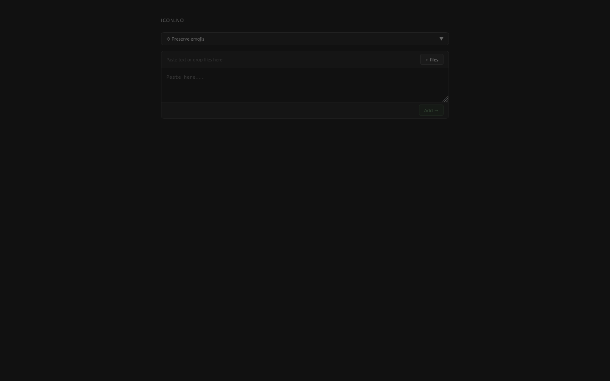
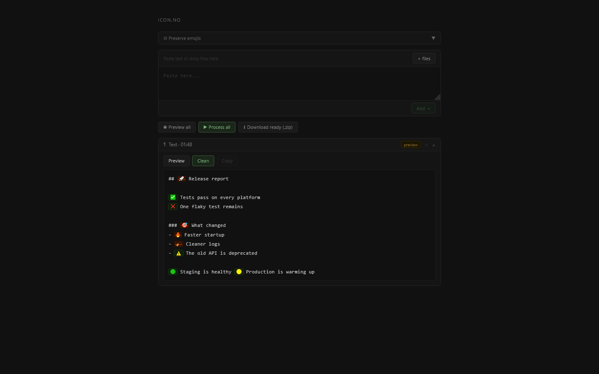
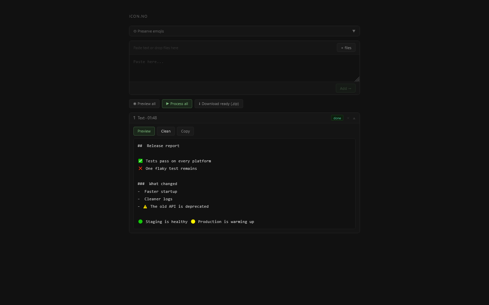
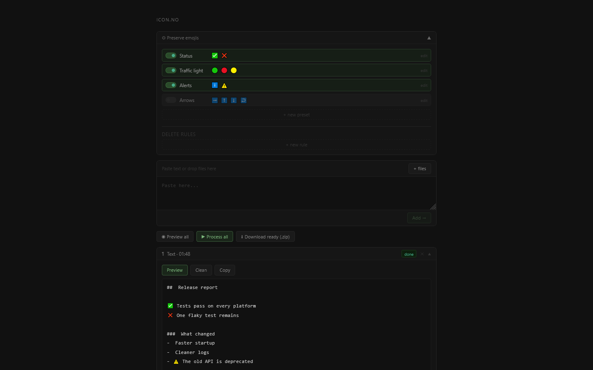

# icon.no guide

How to use icon.no. The [README](../../README.md) says what the tool is for; this page is a short walk through.

Open https://memoriainfinita.github.io/icon.no/, or `index.html` from disk: it needs no server. The text and the files are processed in your browser and never uploaded.

## Clean a text

1. Paste the text in the box and press **Add →**. It appears below as an item
2. **Preview** marks what would be removed and what would be kept. Here the rocket, the target, the flame and the broom go; the check, the cross, the warning and the traffic lights stay

   

3. **Clean** removes them. The item says *done*, and **Copy** puts the clean text on the clipboard

   

## Clean files

Drop one or more files on the box, or press **+ files**. Each one becomes an item with its own **Preview**, **Clean** and download. For several at once: **Preview all**, **Process all** and **Download ready (.zip)**, which gathers the finished ones in one zip.

## Choose what stays

The **Preserve emojis** panel at the top lists the groups of emojis that are kept. Switch a group on or off, and the change takes effect at once.

| Group | Keeps |
|---|---|
| Status | ✅ ❌ |
| Traffic light | 🟢 🔴 🟡 |
| Alerts | ℹ️ ⚠️ |
| Arrows | ➡️ ⬆️ ⬇️ ↩️ (off by default) |

- **edit** changes the emojis of a group, and **+ new preset** makes your own; the defaults can be deleted too
- **Delete rules**, below the groups, are rules of your own for what else to delete, added with **+ new rule**
- Your groups and rules are saved in the browser and survive a reload
